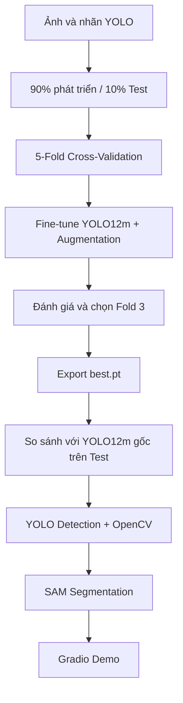
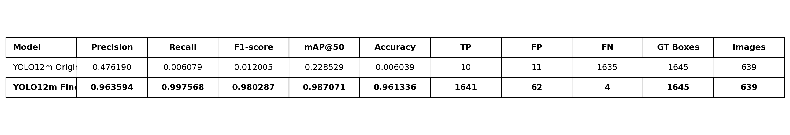
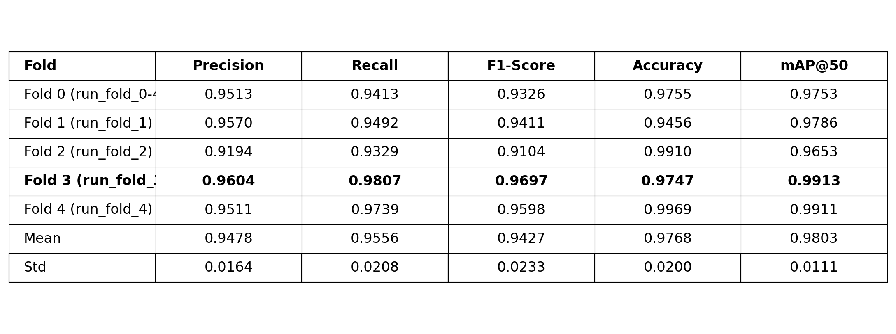

<div align="center">

# 🚦 Vietnamese Traffic Sign Detection & Segmentation

### Hệ thống nhận diện và phân đoạn biển báo giao thông Việt Nam

**YOLO12m Fine-tuning · 5-Fold Cross-Validation · SAM · OpenCV**

<p>
  
  
  
  
</p>

<p>
  <a href="https://github.com/Khoa109dn/vietnamese-traffic-sign-detection"></a>
  <a href="https://colab.research.google.com/drive/1ultzlCs4QgQMpII-2oLdb4HRGUJLHm7R?usp=sharing"></a>
</p>

*Phát hiện vị trí · Phân loại biển báo · Phân đoạn đối tượng · Nhận diện biển chỉ dẫn*

</div>

---

## 📖 Giới thiệu

Dự án xây dựng hệ thống **Traffic Sign Detection & Segmentation** cho biển báo giao thông Việt Nam. **YOLO12m pre-trained** được fine-tune trên dữ liệu có nhãn, đánh giá bằng **5-Fold Cross-Validation** và kết hợp **Segment Anything Model (SAM)** cùng **OpenCV** để nhận diện, phân đoạn và trực quan hóa kết quả.

**Các thành phần chính:**

- **YOLO12m:** Phát hiện bounding box, phân loại biển báo và dự đoán độ tin cậy.
- **5-Fold Cross-Validation:** Đánh giá mô hình qua 5 lượt train/validation.
- **SAM:** Tạo segmentation mask dựa trên bounding box.
- **OpenCV:** Hỗ trợ nhận diện biển chỉ dẫn nền xanh dương, vùng trắng/sáng, dạng hình chữ nhật.
- **Gradio:** Giao diện upload ảnh, chỉnh confidence và bật/tắt SAM/OpenCV.

## 🏆 Kết quả nổi bật

<div align="center">

| **98.03%** | **99.13%** | **98.71%** | **20 Epochs** |
|:---:|:---:|:---:|:---:|
| Mean K-Fold mAP@50 | Best Fold mAP@50 (Fold 3) | Test mAP@50 (Fine-tuned) | Tối đa mỗi fold |

</div>

> Kết quả K-Fold và kết quả đánh giá trên Test là hai phép đo khác nhau. Phép so sánh với YOLO12m gốc được thực hiện theo cách đánh giá định vị biển báo, không phải so sánh phân loại đa lớp tương đương.

---

## 🧩 Quy trình thực hiện



### 1. Chuẩn bị dữ liệu & K-Fold Cross-Validation

1. Khởi tạo mô hình từ trọng số **`yolo12m.pt`**; ánh xạ ảnh với annotation theo định dạng YOLO.
2. Giữ **10% dữ liệu làm Test**; sử dụng **90% còn lại cho 5-Fold Cross-Validation**.
3. Mỗi lượt dùng **4 fold để Train** và **1 fold để Validation**, lần lượt từ Fold 0 đến Fold 4.
4. Lưu YAML, metric và checkpoint của từng fold; chọn checkpoint có **mAP@50 cao nhất**.

### 2. Fine-tuning & Data Augmentation

Cấu hình: **20 epochs tối đa/fold**, **640 × 640**, **batch = 8** và **Early Stopping (`patience = 5`)**.

| Kỹ thuật | Thiết lập | Mục đích |
|:---|:---:|:---|
| **HSV Augmentation** | H `0.015` · S `0.7` · V `0.4` | Thay đổi màu sắc, ánh sáng |
| **Rotation** | `±15°` | Mô phỏng góc ảnh nghiêng |
| **Translation** | `0.1` | Dịch chuyển vị trí |
| **Scaling** | `0.5` | Thay đổi kích thước |
| **Shearing** | `±2°` | Biến đổi hình học |
| **Mosaic** | `1.0` | Kết hợp nhiều ảnh |
| **MixUp** | `0.1` | Trộn ảnh huấn luyện |
| **Horizontal / Vertical Flip** | `0.0 / 0.0` | Tránh đảo hướng biển báo |

**Early Stopping** dừng huấn luyện khi metric theo dõi không cải thiện trong 5 epochs liên tiếp.

### 3. Đánh giá mô hình

Sử dụng **Precision, Recall, F1-Score, mAP@50** và **Accuracy** (theo công thức riêng trong chương trình đánh giá). Kết quả được tổng hợp ở hai mục dưới đây.

---

## 📊 YOLO12m Original vs Fine-tuned

Hai mô hình được chạy trên cùng tập **Test gồm 639 ảnh và 1.645 bounding box Ground Truth**, nhằm đánh giá mức cải thiện sau fine-tuning.

<p align="center">
  
</p>

| Model | Precision | Recall | F1-Score | mAP@50 | Accuracy |
|:---|---:|---:|---:|---:|---:|
| YOLO12m Original | 0.4762 | 0.0061 | 0.0120 | 0.2285 | 0.0060 |
| **YOLO12m Fine-tuned** | **0.9636** | **0.9976** | **0.9803** | **0.9871** | **0.9613** |

Mô hình Fine-tuned đạt **mAP@50 = 98.71%**, phát hiện đúng **1.641/1.645** bounding box Ground Truth tại ngưỡng đánh giá đã chọn (TP = 1.641, FP = 62, FN = 4).

> **Lưu ý:** YOLO12m Original sử dụng lớp COCO `stop sign`, còn mô hình Fine-tuned sử dụng các lớp biển báo đã học; bảng trên phản ánh khả năng **định vị** theo quy tắc đánh giá của notebook, không phản ánh so sánh phân loại đa lớp công bằng. Accuracy ở bảng được tính bằng `TP / (TP + FP + FN)`.

## 🔄 K-Fold Cross-Validation & Best Model

Kết quả của **5 fold** được tổng hợp như sau:

<p align="center">
  
</p>

- **Mean mAP@50:** `0.9803` (**98.03%**).
- **Best Fold:** **Fold 3** với Precision `0.9604`, Recall `0.9807`, F1-Score `0.9697` và **mAP@50 `0.9913` (99.13%)**.
- **Checkpoint được chọn:** `Traffic_Sign_KFold/run_fold_3/weights/best.pt`, xuất thành **`best.pt`** để chạy ứng dụng.

---

## 🧠 Detection, Segmentation & OpenCV

### 🎯 YOLO12m — Traffic Sign Detection

- Nạp checkpoint **`best.pt`** để dự đoán **bounding box, class label, confidence score**.
- Ngưỡng confidence mặc định **`0.5`**, có thể thay đổi trong giao diện.

### 🖌️ SAM — Instance Segmentation

- Sử dụng **`sam_b.pt`** và các bounding box làm box prompts.
- Tạo **segmentation mask**, phủ màu bán trong suốt và vẽ contour bằng OpenCV.

### 🟦 OpenCV — Blue Directional Sign Recognition

1. Chuyển ảnh sang **HSV** để lọc vùng nền xanh dương.
2. Áp dụng **morphological operations** và **contour detection** để tìm vùng ứng viên hình chữ nhật.
3. Kiểm tra tỷ lệ màu xanh, vùng trắng/sáng và các ràng buộc hình dạng.
4. Đối chiếu với box YOLO qua **IoU/độ phủ**, bổ sung biển bỏ sót hoặc gán nhãn **“Biển chỉ dẫn”**.

> Phần OpenCV là phương pháp dựa trên quy tắc, không phải confidence từ YOLO; kết quả có thể có false positive.

### 🖼️ Visualization

Hiển thị **bounding box được đánh số, segmentation mask, ảnh crop, tên biển báo**, độ tin cậy YOLO hoặc nguồn phát hiện (YOLO/OpenCV).

---

## 🧪 Giao diện demo (Gradio)

File **`app.py`** cho phép:

- Upload ảnh giao thông từ máy tính.
- Điều chỉnh confidence từ **`0.1` đến `0.9`** (mặc định `0.5`).
- Bật/tắt **SAM Segmentation** và **OpenCV biển xanh**.
- Xem ảnh kết quả và tổng số biển báo nhận diện.

**🌐 [Truy cập Hugging Face Demo](https://huggingface.co/spaces/Khoa109/vietnamese-traffic-sign-detection)**

## 📂 Cấu trúc repository

```text
vietnamese-traffic-sign-detection/
├── app.py                       # Gradio + YOLO12m + SAM + OpenCV
├── best.pt                      # Fine-tuned checkpoint (Fold 3)
├── requirements.txt             # Python dependencies
├── model_comparison_white.png   # Bảng so sánh hai mô hình
├── kfold_results_white.png      # Bảng 5-Fold Cross-Validation
└── README.md                    # Tài liệu dự án
```

## 🔗 Source Code & Training Notebook

<div align="center">

| 📦 **GitHub Repository** | ☁️ **Google Colab Notebook** |
|:---:|:---:|
| [**Xem source code**](https://github.com/Khoa109dn/vietnamese-traffic-sign-detection) | [**Xem quá trình train & đánh giá**](https://colab.research.google.com/drive/1ultzlCs4QgQMpII-2oLdb4HRGUJLHm7R?usp=sharing) |
| `app.py` · `best.pt` · `requirements.txt` | Data splitting · K-Fold · Fine-tuning · Evaluation |

**[🚀 Mở Demo](https://huggingface.co/spaces/Khoa109/vietnamese-traffic-sign-detection)**

</div>

---

<div align="center">

**Built with YOLO12m · SAM · OpenCV · Gradio**

*Vietnamese Traffic Sign Detection & Segmentation*

</div>
