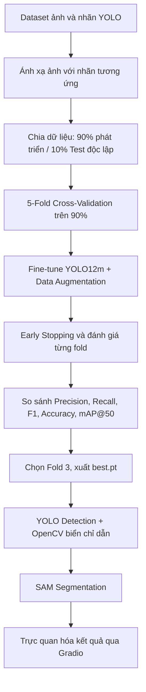

<div align="center">

# 🚦 Vietnamese Traffic Sign Detection & Segmentation

### Hệ thống nhận diện và phân đoạn biển báo giao thông Việt Nam

**YOLO12m Fine-tuning · 5-Fold Cross-Validation · SAM · OpenCV**

<p>
  
  
  
  
</p>

<p>
  <a href="https://github.com/Khoa109dn/vietnamese-traffic-sign-detection">
    
  </a>
  <a href="https://colab.research.google.com/drive/1ultzlCs4QgQMpII-2oLdb4HRGUJLHm7R?usp=sharing">
    
  </a>
</p>

*Phát hiện vị trí · Phân loại biển báo · Phân đoạn đối tượng · Nhận diện biển chỉ dẫn*

</div>

---

## 📖 Giới thiệu

Dự án xây dựng một hệ thống **Traffic Sign Detection & Segmentation** cho biển báo giao thông Việt Nam. Mô hình **YOLO12m pre-trained** được **fine-tune** trên dữ liệu có nhãn, đánh giá bằng **5-Fold Cross-Validation**, sau đó tích hợp với **Segment Anything Model (SAM)** và **OpenCV** để nhận diện, phân đoạn và trực quan hóa các biển báo trong ảnh.

**Các thành phần chính:**

- **YOLO12m:** Phát hiện bounding box, dự đoán loại biển báo và độ tin cậy.
- **K-Fold Cross-Validation:** Đánh giá mô hình qua 5 lần chia train/validation.
- **SAM:** Tạo segmentation mask từ bounding box của đối tượng.
- **OpenCV:** Hỗ trợ phát hiện **biển chỉ dẫn** qua đặc trưng nền xanh dương, vùng sáng/trắng và hình dạng chữ nhật.
- **Gradio:** Giao diện tải ảnh, tùy chỉnh ngưỡng confidence và bật/tắt SAM hoặc OpenCV.

## 🏆 Kết quả nổi bật

<div align="center">

| **98.03%** | **99.13%** | **5 Folds** | **20 Epochs** |
|:---:|:---:|:---:|:---:|
| mAP@50 trung bình | mAP@50 tốt nhất (Fold 3) | Cross-Validation | Tối đa mỗi fold |

</div>

> **Lưu ý:** Các số liệu trên là kết quả **cross-validation** được cung cấp từ quá trình huấn luyện; không đồng nghĩa với hiệu năng đã được xác nhận trên tập **Test độc lập 10%**.

---

## 🧩 Quy trình thực hiện



### 1. Chuẩn bị dữ liệu & K-Fold Cross-Validation

1. Tải **pre-trained weights** `yolo12m.pt` để khởi tạo mô hình và tiến hành fine-tuning.
2. Ghép từng ảnh với **nhãn annotation đã được gán sẵn**; chuẩn hóa cấu trúc thư mục ảnh/nhãn theo định dạng YOLO.
3. Giữ lại **10% dữ liệu làm tập Test độc lập**, không đưa vào quá trình chọn mô hình.
4. Chia **90% dữ liệu còn lại** thành **5 fold (0–4)**. Mỗi lượt sử dụng **4 fold để Train**, **1 fold để Validation** và luân phiên qua cả 5 fold.
5. Tạo cấu hình YAML tương ứng với từng fold, fine-tune và lưu lại kết quả đánh giá, trọng số tốt nhất.

### 2. Fine-tuning & Data Augmentation

Mô hình được fine-tune với **20 epochs tối đa cho mỗi fold**, ảnh đầu vào **640 × 640** và **batch size = 8**. Các kỹ thuật tăng cường dữ liệu giúp mô hình thích nghi tốt hơn với sự thay đổi về màu sắc, điều kiện chiếu sáng, góc nhìn và kích thước biển báo.

| Kỹ thuật | Thiết lập | Mục đích |
|:---|:---:|:---|
| 🌈 **HSV Augmentation** | H: `0.015` · S: `0.7` · V: `0.4` | Thay đổi sắc độ, độ bão hòa và độ sáng |
| 🔄 **Rotation** | `±15°` | Mô phỏng góc chụp bị nghiêng |
| ↔️ **Translation** | `0.1` | Dịch chuyển vị trí đối tượng |
| 🔍 **Scaling** | `0.5` | Tăng tính đa dạng về kích thước |
| 📐 **Shearing** | `±2°` | Mô phỏng biến dạng phối cảnh nhẹ |
| 🧩 **Mosaic** | `1.0` | Kết hợp 4 ảnh trong một mẫu huấn luyện |
| 🫧 **MixUp** | `0.1` | Trộn ảnh để hỗ trợ khả năng tổng quát hóa |
| 🚫 **Horizontal / Vertical Flip** | `0.0 / 0.0` | Tránh thay đổi hướng và ý nghĩa biển báo |

**Early Stopping:** `patience = 5` — tự động kết thúc huấn luyện nếu chỉ số theo dõi không cải thiện trong **5 epochs liên tiếp**, giúp giảm thời gian huấn luyện không cần thiết và hạn chế overfitting.

### 3. Đánh giá mô hình

Sau mỗi fold, mô hình được tổng hợp và so sánh thông qua **Precision**, **Recall**, **F1-Score**, **Accuracy** *(theo cách tính trong chương trình đánh giá)* và **mAP@50**.

| Fold | Precision | Recall | F1-Score | Accuracy | mAP@50 |
|:---|---:|---:|---:|---:|---:|
| Fold 0 | 0.9513 | 0.9413 | 0.9326 | 0.9755 | 0.9753 |
| Fold 1 | 0.9570 | 0.9492 | 0.9411 | 0.9456 | 0.9786 |
| Fold 2 | 0.9194 | 0.9329 | 0.9104 | 0.9910 | 0.9653 |
| **Fold 3 🥇** | **0.9604** | **0.9807** | **0.9697** | **0.9747** | **0.9913** |
| Fold 4 | 0.9511 | 0.9739 | 0.9598 | 0.9969 | 0.9911 |
| **Mean** | **0.9478** | **0.9556** | **0.9427** | **0.9768** | **0.9803** |
| Std | 0.0164 | 0.0208 | 0.0233 | 0.0200 | 0.0111 |

**Fold 3** có **mAP@50 cao nhất: `0.9913` (99.13%)**, nên được chọn làm trọng số sử dụng ở bước inference.

```text
# Trọng số tốt nhất sau huấn luyện trên Google Colab
/content/runs/detect/Traffic_Sign_KFold/run_fold_3/weights/best.pt

# Trọng số được đưa vào repository để chạy ứng dụng
best.pt
```

> **Ghi chú đánh giá:** `mAP@50` là chỉ số phổ biến cho object detection. `Accuracy` phụ thuộc công thức đánh giá riêng và không nên diễn giải như classification accuracy nếu chưa xác định rõ cách tính. Kết quả của tập Test giữ lại cần được báo cáo riêng.

---

## 🧠 Detection, Segmentation & OpenCV

### 🎯 YOLO12m — Traffic Sign Detection

- Tải checkpoint `best.pt` sau fine-tuning.
- Phát hiện biển báo và suy luận **bounding box**, **class label**, **confidence score**.
- Ngưỡng confidence mặc định: **`0.5`**, có thể điều chỉnh trên giao diện.

### 🖌️ SAM — Instance Segmentation

- Sử dụng checkpoint **`sam_b.pt`**.
- Truyền các bounding box nhận diện được làm **box prompts** cho SAM.
- Nhận segmentation mask, phủ màu bán trong suốt và vẽ viền đối tượng bằng **`cv2.findContours()`** / **`cv2.drawContours()`**.

### 🟦 OpenCV — Blue Directional Sign Recognition

Để bổ sung trường hợp YOLO chưa nhận ra biển chỉ dẫn, ứng dụng sử dụng **xử lý ảnh dựa trên quy tắc**:

1. Chuyển ảnh RGB sang **HSV**, tạo mặt nạ màu **xanh dương** bằng `cv2.inRange()`.
2. Áp dụng **Morphological Closing** để nối các vùng màu và giảm khoảng trống trong mask.
3. Dùng **Contour Detection** và **Polygon Approximation** để tìm vùng gần **hình chữ nhật**.
4. Kiểm tra thêm tỷ lệ vùng màu xanh và vùng **trắng/sáng** bên trong biển.
5. So khớp với các box từ YOLO thông qua **IoU/độ phủ** để bổ sung biển bỏ sót hoặc hiệu chỉnh thành nhãn **“Biển chỉ dẫn”**.

> Đây là **heuristic của OpenCV**, không phải độ tin cậy từ mô hình YOLO. Các vùng có đặc trưng tương tự có thể phát sinh nhận diện nhầm và cần được kiểm thử thêm.

### 🖼️ Visualization

Ảnh kết quả hiển thị **bounding box được đánh số**, vùng segmentation, ảnh crop từng biển, tên biển báo, cùng thông tin độ tin cậy hoặc nguồn nhận diện (YOLO / OpenCV).

---

## 🧪 Giao diện demo (Gradio)

File `app.py` cung cấp giao diện cho phép:

- **Tải ảnh** giao thông từ thiết bị.
- Thay đổi **confidence threshold** từ `0.1` đến `0.9` (mặc định `0.5`).
- **Bật/tắt SAM Segmentation** và **OpenCV nhận diện biển xanh**.
- Xem ảnh kết quả nhận diện và tổng số biển báo tìm thấy.

Ứng dụng được viết theo cấu hình **Gradio + Hugging Face Spaces / ZeroGPU**. Repository hiện cung cấp mã nguồn ứng dụng; **chưa đính kèm URL của bản demo đang chạy công khai**.

## 📂 Cấu trúc repository

```text
vietnamese-traffic-sign-detection/
├── app.py             # Gradio UI + YOLO12m + SAM + OpenCV
├── best.pt            # Fine-tuned checkpoint được chọn (Fold 3)
├── requirements.txt   # Danh sách thư viện Python
└── README.md          # Tài liệu dự án
```

## 🔗 Source Code & Training Notebook

<div align="center">

| 📦 **GitHub Repository** | ☁️ **Google Colab Notebook** |
|:---:|:---:|
| [**Xem source code**](https://github.com/Khoa109dn/vietnamese-traffic-sign-detection) | [**Xem quá trình train & đánh giá**](https://colab.research.google.com/drive/1ultzlCs4QgQMpII-2oLdb4HRGUJLHm7R?usp=sharing) |
| `app.py` · `best.pt` · `requirements.txt` | Data splitting · K-Fold · Fine-tuning · Evaluation |

</div>

---

<div align="center">

**Built with YOLO12m · SAM · OpenCV · Gradio**

*Vietnamese Traffic Sign Detection & Segmentation*

</div>
