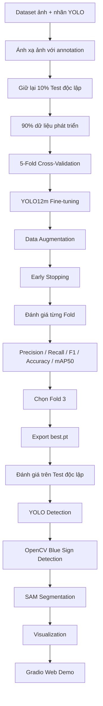

<div align="center">

# 🚦 Vietnamese Traffic Sign Detection & Segmentation

### Hệ thống nhận diện và phân đoạn biển báo giao thông Việt Nam

**YOLO12m Fine-tuning · 5-Fold Cross-Validation · SAM · OpenCV**

<p>
  
  
  
  
</p>

<p>
  <a href="https://github.com/Khoa109dn/vietnamese-traffic-sign-detection">
    
  </a>

  <a href="https://colab.research.google.com/drive/1ultzlCs4QgQMpII-2oLdb4HRGUJLHm7R?usp=sharing">
    
  </a>
</p>

*Phát hiện vị trí · Phân loại biển báo · Phân đoạn đối tượng · Nhận diện biển chỉ dẫn*

</div>

---

## 📖 Giới thiệu

Dự án xây dựng hệ thống **Traffic Sign Detection & Segmentation** dành cho biển báo giao thông Việt Nam.

Mô hình **YOLO12m pre-trained** được fine-tune trên bộ dữ liệu biển báo đã được gán nhãn, sau đó đánh giá bằng **5-Fold Cross-Validation** để lựa chọn checkpoint tốt nhất.

Sau quá trình huấn luyện, mô hình YOLO12m được kết hợp với **Segment Anything Model (SAM)** và **OpenCV** nhằm xây dựng pipeline hoàn chỉnh gồm:

- Phát hiện biển báo.
- Phân loại biển báo.
- Trích xuất Bounding Box.
- Tính Confidence Score.
- Phân đoạn đối tượng bằng SAM.
- Bổ sung nhận diện biển chỉ dẫn nền xanh bằng OpenCV.
- Trực quan hóa kết quả thông qua Gradio.

### Các thành phần chính

- **YOLO12m:** Phát hiện Bounding Box, dự đoán class và Confidence Score.
- **K-Fold Cross-Validation:** Đánh giá mô hình trên 5 tập Validation khác nhau.
- **SAM:** Tạo Segmentation Mask từ các Bounding Box được YOLO/OpenCV phát hiện.
- **OpenCV:** Hỗ trợ phát hiện biển chỉ dẫn dựa trên màu xanh dương, vùng trắng và đặc trưng hình chữ nhật.
- **Gradio:** Xây dựng giao diện web để upload ảnh và chạy inference.

---

## 🏆 Kết quả nổi bật

<div align="center">

| **98.03%** | **99.13%** | **98.71%** | **99.76%** |
|:---:|:---:|:---:|:---:|
| Mean K-Fold mAP@50 | Best Fold mAP@50 | Test mAP@50 | Test Recall |

</div>

### Mô hình cuối cùng

```text
Model: YOLO12m Fine-tuned
Best Fold: Fold 3
Cross-Validation mAP@50: 99.13%
Independent Test mAP@50: 98.71%
Checkpoint: best.pt
```

---

## 🧩 Quy trình thực hiện



---

## 1. 📂 Chuẩn bị dữ liệu

Dữ liệu bao gồm:

```text
Dataset/
├── images/
├── labels/
└── split_dataset/
    ├── train_files.txt
    └── test_files.txt
```

Mỗi ảnh được ánh xạ với file annotation tương ứng theo định dạng YOLO:

```text
<class_id> <center_x> <center_y> <width> <height>
```

Các tọa độ Bounding Box được chuẩn hóa trong khoảng:

```text
0.0 → 1.0
```

### Data Split

Bộ dữ liệu được chia thành:

- **90% dữ liệu:** sử dụng cho Training + Validation.
- **10% dữ liệu:** giữ lại làm **Independent Test Set**.

Tập Test không tham gia vào quá trình lựa chọn mô hình.

---

## 2. 🔄 5-Fold Cross-Validation

90% dữ liệu phát triển được chia thành:

```text
Fold 0
Fold 1
Fold 2
Fold 3
Fold 4
```

Trong mỗi lần huấn luyện:

```text
4 Folds → Training
1 Fold  → Validation
```

Quá trình được lặp lại 5 lần để mỗi fold đều được sử dụng làm Validation đúng một lần.

Ví dụ:

```text
Run 1:
Train → Fold 1 + 2 + 3 + 4
Val   → Fold 0

Run 2:
Train → Fold 0 + 2 + 3 + 4
Val   → Fold 1

...

Run 5:
Train → Fold 0 + 1 + 2 + 3
Val   → Fold 4
```

---

## 3. 🧠 YOLO12m Fine-tuning

Mô hình được khởi tạo bằng trọng số:

```text
yolo12m.pt
```

Sau đó fine-tune trên dữ liệu biển báo giao thông Việt Nam.

### Training Configuration

```python
results = model.train(
    data=yaml_path,
    epochs=20,
    imgsz=640,
    batch=8,
    patience=5,
    project="Traffic_Sign_KFold",
    name=f"run_fold_{fold}",

    hsv_h=0.015,
    hsv_s=0.7,
    hsv_v=0.4,

    degrees=15.0,
    translate=0.1,
    scale=0.5,
    shear=2.0,

    mosaic=1.0,
    mixup=0.1,

    fliplr=0.0,
    flipud=0.0
)
```

---

## 4. 🎨 Data Augmentation

Các kỹ thuật Data Augmentation được sử dụng nhằm tăng khả năng tổng quát hóa của mô hình.

| Kỹ thuật | Thiết lập | Mục đích |
|:---|:---:|:---|
| 🌈 **HSV Augmentation** | H `0.015`, S `0.7`, V `0.4` | Thay đổi màu sắc, độ bão hòa và ánh sáng |
| 🔄 **Rotation** | `±15°` | Mô phỏng ảnh chụp bị nghiêng |
| ↔️ **Translation** | `0.1` | Dịch chuyển vị trí biển báo |
| 🔍 **Scaling** | `0.5` | Thay đổi kích thước đối tượng |
| 📐 **Shearing** | `±2°` | Mô phỏng biến dạng phối cảnh |
| 🧩 **Mosaic** | `1.0` | Ghép nhiều ảnh thành một sample |
| 🫧 **MixUp** | `0.1` | Trộn hai ảnh training |
| 🚫 **Horizontal Flip** | `0.0` | Không sử dụng |
| 🚫 **Vertical Flip** | `0.0` | Không sử dụng |

Không sử dụng Horizontal Flip hoặc Vertical Flip vì việc đảo hướng có thể làm thay đổi ý nghĩa của một số biển báo.

---

## 5. ⏹️ Early Stopping

Training sử dụng:

```text
patience = 5
```

Quá trình huấn luyện sẽ dừng nếu metric theo dõi không cải thiện trong **5 epoch liên tiếp**.

Điều này giúp:

- Hạn chế overfitting.
- Giảm thời gian huấn luyện không cần thiết.
- Tiết kiệm GPU.
- Giữ checkpoint tốt nhất.

---

# 📊 Model Evaluation

Các metric được sử dụng để đánh giá:

### Precision

```text
Precision = TP / (TP + FP)
```

### Recall

```text
Recall = TP / (TP + FN)
```

### F1-Score

```text
F1 = 2 × Precision × Recall / (Precision + Recall)
```

### Detection Accuracy

```text
Accuracy = TP / (TP + FP + FN)
```

### mAP@50

Mean Average Precision tại:

```text
IoU = 0.5
```

---

# 📈 YOLO12m Original vs Fine-tuned

Để đánh giá mức cải thiện sau fine-tuning, hai mô hình được chạy trên **cùng một tập Test độc lập**.

### Test Dataset

```text
Images: 639
Ground Truth Boxes: 1645
```

<p align="center">
  
</p>

### Kết quả

| Model | Precision | Recall | F1-Score | mAP@50 | Accuracy |
|:---|---:|---:|---:|---:|---:|
| YOLO12m Original | 0.4762 | 0.0061 | 0.0120 | 0.2285 | 0.0060 |
| **YOLO12m Fine-tuned** | **0.9636** | **0.9976** | **0.9803** | **0.9871** | **0.9613** |

### Detection Statistics

| Model | TP | FP | FN | GT Boxes |
|:---|---:|---:|---:|---:|
| YOLO12m Original | 10 | 11 | 1635 | 1645 |
| **YOLO12m Fine-tuned** | **1641** | **62** | **4** | **1645** |

### Kết quả Fine-tuned Model

```text
Precision = 96.36%
Recall    = 99.76%
F1-Score  = 98.03%
mAP@50    = 98.71%
Accuracy  = 96.13%
```

Trong tổng số:

```text
1645 Ground Truth Boxes
```

mô hình Fine-tuned phát hiện đúng:

```text
1641 biển báo
```

và bỏ sót:

```text
4 biển báo
```

### Nhận xét

Kết quả cho thấy việc fine-tuning YOLO12m trên dữ liệu biển báo giao thông Việt Nam giúp cải thiện đáng kể khả năng phát hiện.

Đặc biệt:

```text
Recall:
0.0061 → 0.9976

F1-score:
0.0120 → 0.9803

mAP@50:
0.2285 → 0.9871
```

> **Lưu ý:** YOLO12m Original chưa được huấn luyện chuyên biệt cho hệ thống class biển báo giao thông Việt Nam. Do đó, kết quả này chủ yếu thể hiện mức cải thiện sau **domain-specific fine-tuning**.

---

# 🔄 K-Fold Cross-Validation Results

Sau quá trình Fine-tuning, kết quả từ 5 Fold được tổng hợp như sau:

<p align="center">
  
</p>

| Fold | Precision | Recall | F1-Score | Accuracy | mAP@50 |
|:---|---:|---:|---:|---:|---:|
| Fold 0 | 0.9513 | 0.9413 | 0.9326 | 0.9755 | 0.9753 |
| Fold 1 | 0.9570 | 0.9492 | 0.9411 | 0.9456 | 0.9786 |
| Fold 2 | 0.9194 | 0.9329 | 0.9104 | 0.9910 | 0.9653 |
| **Fold 3 🥇** | **0.9604** | **0.9807** | **0.9697** | **0.9747** | **0.9913** |
| Fold 4 | 0.9511 | 0.9739 | 0.9598 | 0.9969 | 0.9911 |
| **Mean** | **0.9478** | **0.9556** | **0.9427** | **0.9768** | **0.9803** |
| Std | 0.0164 | 0.0208 | 0.0233 | 0.0200 | 0.0111 |

### Mean Performance

```text
Precision = 0.9478
Recall    = 0.9556
F1-Score  = 0.9427
Accuracy  = 0.9768
mAP@50    = 0.9803
```

Tương đương:

```text
Mean mAP@50 = 98.03%
```

---

# 🥇 Best Model Selection — Fold 3

Trong 5 Fold, **Fold 3** đạt giá trị mAP@50 cao nhất:

```text
Precision = 0.9604
Recall    = 0.9807
F1-Score  = 0.9697
Accuracy  = 0.9747
mAP@50    = 0.9913
```

### Best mAP@50

```text
99.13%
```

Do đó Fold 3 được lựa chọn làm checkpoint cuối cùng.

```text
/content/runs/detect/Traffic_Sign_KFold/run_fold_3/weights/best.pt
```

Sau khi export:

```text
best.pt
```

được sử dụng trong ứng dụng inference.

### Final Model Pipeline

```text
YOLO12m Pre-trained
        │
        ▼
Fine-tuning
        │
        ▼
5-Fold Cross-Validation
        │
        ▼
Fold 3 — mAP@50 = 99.13%
        │
        ▼
best.pt
        │
        ▼
Independent Test
        │
        ▼
mAP@50 = 98.71%
        │
        ▼
YOLO + OpenCV + SAM
        │
        ▼
Gradio Web Application
```

---

# 🧠 Detection, Segmentation & OpenCV

## 🎯 YOLO12m — Traffic Sign Detection

Checkpoint:

```text
best.pt
```

YOLO12m chịu trách nhiệm:

- Phát hiện vị trí biển báo.
- Sinh Bounding Box.
- Phân loại biển báo.
- Tính Confidence Score.

Ngưỡng Confidence mặc định:

```text
0.5
```

Người dùng có thể điều chỉnh ngưỡng này trong giao diện Gradio.

---

## 🖌️ SAM — Instance Segmentation

Sau khi YOLO/OpenCV tìm được vị trí biển báo, Bounding Box được truyền vào **Segment Anything Model**.

Checkpoint:

```text
sam_b.pt
```

Pipeline:

```text
Bounding Box
      │
      ▼
SAM Box Prompt
      │
      ▼
Segmentation Mask
      │
      ▼
Contour Extraction
```

OpenCV được sử dụng để lấy đường viền:

```python
cv2.findContours()
```

và trực quan hóa:

```python
cv2.drawContours()
```

Segmentation Mask được phủ màu bán trong suốt lên ảnh gốc.

---

# 🟦 OpenCV — Blue Directional Sign Detection

Một số biển chỉ dẫn nền xanh có thể chưa được YOLO nhận diện tốt.

Do đó hệ thống bổ sung một pipeline OpenCV dựa trên đặc trưng hình ảnh.

## Các bước xử lý

### 1. RGB → HSV

```python
hsv = cv2.cvtColor(image, cv2.COLOR_RGB2HSV)
```

HSV giúp tách màu xanh ổn định hơn RGB.

### 2. Blue Mask

Sử dụng:

```python
cv2.inRange()
```

để xác định các vùng màu xanh.

### 3. Morphological Processing

Áp dụng:

```python
cv2.morphologyEx()
```

nhằm:

- Nối vùng màu xanh bị đứt.
- Loại bỏ khoảng trống nhỏ.
- Ổn định Contour.

### 4. Contour Detection

```python
cv2.findContours()
```

được sử dụng để tìm vùng ứng viên.

### 5. Shape Filtering

Các vùng ứng viên được lọc dựa trên:

```text
Width
Height
Area
Aspect Ratio
Rectangularity
```

Mục tiêu là tìm:

```text
Blue + Rectangle
```

### 6. Color Ratio

Kiểm tra tỷ lệ Pixel xanh nằm trong Bounding Box.

Ngoài ra kiểm tra:

- Vùng sáng.
- Vùng trắng.
- Đặc trưng chữ/ký hiệu trên biển.

### 7. YOLO/OpenCV Fusion

Nếu OpenCV tìm được biển xanh trùng với YOLO:

```text
YOLO Box
   +
OpenCV Box
   ↓
IoU / Coverage
```

Box được cập nhật thành:

```text
Biển chỉ dẫn
```

Nếu YOLO bỏ sót hoàn toàn:

```text
OpenCV Candidate
        ↓
Add new detection
        ↓
Biển chỉ dẫn
```

> OpenCV sử dụng heuristic dựa trên màu sắc và hình dạng, do đó không phải Confidence Score từ Deep Learning Model.

---

# 🖼️ Visualization

Kết quả cuối cùng bao gồm:

- Bounding Box.
- Số thứ tự biển báo.
- Segmentation Mask.
- Contour.
- Crop ảnh biển báo.
- Class name.
- Confidence Score.
- Nguồn Detection.

Ví dụ nguồn nhận diện:

```text
YOLO
YOLO + OpenCV
OpenCV
```

---

# 🧪 Giao diện Demo — Gradio

Ứng dụng được triển khai thông qua:

```text
Gradio
+
Hugging Face Spaces
+
ZeroGPU
```

File:

```text
app.py
```

cung cấp giao diện cho phép người dùng:

- Upload ảnh giao thông.
- Điều chỉnh Confidence Threshold.
- Bật/Tắt SAM Segmentation.
- Bật/Tắt OpenCV Blue Sign Detection.
- Xem ảnh Detection + Segmentation.
- Xem số lượng biển báo được phát hiện.

### Confidence Slider

```text
Minimum: 0.1
Maximum: 0.9
Default: 0.5
```

### SAM

```text
☑ Bật SAM Segmentation
```

### OpenCV

```text
☑ Bật OpenCV biển xanh
```

---

# 🚀 Demo

<div align="center">

### Hugging Face Spaces

[**🚦 Open Traffic Sign Detection Demo**](https://huggingface.co/spaces/Khoa109/vietnamese-traffic-sign-detection)

</div>

---

# 📂 Repository Structure

```text
vietnamese-traffic-sign-detection/
│
├── app.py
│   └── Gradio + YOLO12m + SAM + OpenCV
│
├── best.pt
│   └── Fine-tuned YOLO12m — Fold 3
│
├── requirements.txt
│   └── Python dependencies
│
├── model_comparison_white.png
│   └── Original vs Fine-tuned comparison
│
├── kfold_results_white.png
│   └── 5-Fold Cross-Validation results
│
└── README.md
```

---

# 🔗 Source Code & Training Notebook

<div align="center">

| 📦 **GitHub Repository** | ☁️ **Google Colab Notebook** |
|:---:|:---:|
| [**Xem Source Code**](https://github.com/Khoa109dn/vietnamese-traffic-sign-detection) | [**Xem Training Notebook**](https://colab.research.google.com/drive/1ultzlCs4QgQMpII-2oLdb4HRGUJLHm7R?usp=sharing) |
| `app.py` · `best.pt` · `requirements.txt` | Data Split · K-Fold · Fine-tuning · Evaluation |

</div>

---

# 🛠️ Technologies

<div align="center">

**Python · PyTorch · Ultralytics · YOLO12m · SAM · OpenCV · NumPy · PIL · Gradio**

</div>

---

# 📌 Model Summary

```text
Base Model
└── YOLO12m

Fine-tuning
├── Image Size: 640 × 640
├── Epochs: 20
├── Batch Size: 8
├── Data Augmentation
└── Early Stopping: patience = 5

Validation
└── 5-Fold Cross-Validation
    └── Best Fold: Fold 3
        └── mAP@50 = 99.13%

Independent Test
├── Images: 639
├── Ground Truth: 1645
├── Precision: 96.36%
├── Recall: 99.76%
├── F1-score: 98.03%
├── mAP@50: 98.71%
└── Accuracy: 96.13%

Inference
├── YOLO12m Detection
├── OpenCV Blue Sign Detection
├── SAM Segmentation
└── Gradio Visualization
```

---

<div align="center">

## 🚦 Vietnamese Traffic Sign Detection & Segmentation

**Built with YOLO12m · SAM · OpenCV · Gradio**

*Computer Vision for Vietnamese Traffic Sign Recognition*

</div>
